# 界面预览

本文对应基于 **v0.3.0** 的当前开发版本（含主题切换），截图于 **2026-10-19** 使用原生窗口重新导出。
预览使用合成颜色、指定的亮色或暗色主题和其他默认设置；取色浮窗使用合成棋盘背景展示磨砂效果。
所有图片保持原始像素尺寸，本轮导出环境为 Windows、125% 缩放（120 DPI）。
截图中的屏幕坐标随导出时的显示器工作区变化，不是固定示例值。

## 当前界面

2026-10-19：结果窗口增加调色盘，默认尺寸为 420×392 DIP，最终复制失败时高度展开至 418 DIP。
顶部预览由原来的 112 DIP 减半为 56 DIP，左半始终显示原始取色，右半显示当前调整色，
两半均不显示文字标签。其下紧贴 84 DIP 高的 3×7 无缝色格，三行依次为明暗、相邻色相和浓淡。
鼠标悬浮某行时，滚轮只浏览该行候选，不改变当前色或剪贴板；点击才选色，
三行均以所选 RGB 为基准重新生成并居中。候选通过 OKLCH 调整明度、色相和色度，
再映射为可显示的 RGB；中性灰的色相与浓淡行保持灰色。色格获得焦点后，方向键仅移动焦点，
Enter / Space 选择颜色；
四种格式与复制均使用当前调整色。
点击左半原始色块可恢复首次取色 RGB，重置三行候选及其滚轮位置，并同步恢复四种格式，
不会自动复制；右半仍可拖动窗口。

正常复制只让对应按钮短暂显示“已复制”，窗口位置和大小保持稳定。
只有最终复制失败才展开详细状态栏，并保证反馈留在工作区内；重试成功后收回。
右、下两侧复用取色浮窗的灰蓝边框和 0–6 DIP 粗细设置；最大粗细也不会被反馈区域遮住。
结果窗口在 Windows 10 / 11 上统一采用直角、无系统阴影的扁平样式，只保留上述自定义边框。
通过关闭该窗口的 DWM 非客户区渲染，并在 Windows 11 上显式禁止圆角实现；
Windows 10 不支持的圆角 / 边框颜色属性按可选项处理。
来源与原始屏幕坐标位于调色盘下方，不随调整色改变；
亮色主题的色值区采用白底列表、浅灰圆角字段、等宽数值与无边框行内复制，默认复制为深色主操作；
暗色主题使用深色列表与字段、浅色文字和主操作。
剪贴板暂时被占用时会有限重试，成功或失败后停止；Tab / Enter / Esc 保留。
只读文本切换焦点时清除旧选区，同一时间仅保留当前文本框的选中；支持鼠标与键盘选择，
不显示输入光标。标签保持在字段外，色值与复制按钮共享字段底色，用留白区分行；
窄窗口将标签放在字段上方。不显示横纵网格线；无滚动条时列表保持左右等边距。
亮色设置使用浅灰背景、白色卡片与蓝色主操作；暗色设置使用深色背景与卡片。
下拉选择框使用带内边距的圆角字段和一体箭头，展开后的选项也使用当前主题；
复选框为随 DPI 缩放的圆角方框，选中、禁用和键盘焦点各有反馈。
内容滚动条采用与背景一致的轨道及窄圆角滑块，保持完整的鼠标命中区域。
语言与主题、快捷键、复制行为和取色外观分成四张卡片；语言、主题、主键与格式共用编辑器列，
空间不足时改为上下排列。滑块标题与数值同行，轨道放在下一行。
说明与复选框按实际控件字体测量换行，下拉框按实际收起高度居中。
设置页按内容区实际宽度保持左右等边距，仅需要滚动时占用原生滚动条空间；
语言标签与下拉框按实际控件高度居中对齐。底部简短提示使用不可选中的静态文字，
长诊断信息仍可通过滚动详情完整阅读。
应用、托盘、结果 / 设置窗口、安装器共用透明底的青蓝滴管图标，提供 16–256 像素的九档尺寸。
图标源文件为 `resources/app.svg`，可运行 `scripts/generate-icon.ps1` 重建 ICO；正常构建无需图标生成工具。
应用支持简体中文和英文，首次使用跟随 Windows 显示语言，非中文使用英文。
设置页顶部的语言下拉框只修改草稿；点击“应用”保存成功后立即刷新设置、托盘与后续取色窗口，
无需重启，并保留当前滚动位置。保存失败或快捷键冲突时仍使用原语言。
语言和主题均不变时，应用后仅更新保存提示，复用现有文案、字体和预览，避免整页重排重绘造成闪动。
旧配置缺少 `language` 时使用系统默认语言；保存的 `zh-CN` / `en` 选择在重启后保留。
主题下拉框提供亮色与暗色，默认亮色，不自动跟随系统。选择只修改草稿；仅在“应用”保存成功后立即切换，
重启后保留。保存失败或快捷键冲突时继续使用原主题，关闭设置会放弃未应用的更改。
设置、结果窗口、实时和冻结取色浮窗共用活动主题；信息区、文字、边框和磨砂 tint 随主题切换，
采样色块与放大像素保持原值，保留原有命中映射。旧配置缺少 `theme` 时使用亮色，字段只接受 `light` / `dark`。
颜色值使用等宽字体，中文使用 Microsoft YaHei UI，英文使用 Segoe UI。

所有交互仍为原生 Win32 控件。只读色值可选择，Tab / Enter / Esc、复制重试、
设置验证和仅“应用”时保存的行为保留。行内复制按钮显示简短“复制”，
原生控件名称保留完整格式，供辅助技术区分。
部分原生控件表面与弹出菜单仍可能采用 Windows 的系统外观。

设置中的“快速取色”默认关闭。启用后始终复制默认格式，成功时不显示结果窗口、不抢焦点，
失败才显示结果供手动复制和重试；普通模式的自动复制偏好仍保留。
首次手动启动显示简短指引，登录启动保持安静；托盘菜单和提示显示当前快捷键及注册状态。
设置打开期间再次取色会恢复已有设置窗口，并解释需先应用并关闭，不增加额外按钮。

主键现在点击后监听 A–Z、0–9 或 F1–F11，Esc / Tab / 离开控件可取消。
修饰键仍单独选择，按“应用”后才保存；监听只处理设置窗口的按键消息。
已消费的按键保持到释放，避免长按 Enter 或切换焦点时意外应用设置。

设置页的“取色外观”提供边框粗细（0–6 DIP）与背景透明度（0–80%）两个滑块，
旁边显示当前数值，下方使用合成颜色即时预览，不采集桌面。默认 2 DIP / 35%；
0 DIP 隐藏边框，0% 使用不透明背景。滑动只修改草稿；“应用”成功后下次取色生效并在重启后保留，
关闭会放弃未应用更改。设置窗口高度按显示器工作区限制，内容支持滚动和 Tab 自动定位，
底部状态、关闭和应用按钮固定可见。
滚动区域分成固定视口和整块内容窗口，控件、卡片背景共享内容坐标；
滚轮或拖动滚动条只移动内容窗口，不重排控件、重设字体或重建预览。
原生滚动条跟踪在窗口回调中同步更新，不依赖退出 Windows 内部拖动消息循环后才处理。
视口使用后代双缓冲，布局时批量调整控件，再使完整子树失效。
旧配置缺少外观字段时使用默认值，无需手动修改配置文件。

实时浮窗默认 168×38 DIP，左侧色块贴边铺满高度，HEX / 坐标使用 13 / 10 DIP 字号。
边框超过 2 DIP 时按需增加高度，最大 42 DIP，避免底边遮挡坐标；设置预览共用这一布局。
冻结像素区取消外围边距，每轴按 240 DIP 随显示器缩放，再向下取完整 4× 像素格；
125% 为 300×300、175% 为 420×420 物理像素，屏幕中央与边缘尺寸一致。
先确定窗口位置，再按初始 4× 倍率规划对应的局部快照（175% 为 105×105），
使有效像素格内的鼠标在初次冻结时仍命中原像素。工作区不足时缩小；捕获每轴最多 512 个源像素。
信息栏保持 28 DIP 单行，HEX / 倍率与坐标使用随 DPI 缩放的 13 / 10 DIP 字号；
色值左侧的色块扣除底部边框后保持正方形，贴齐信息栏左侧，随当前 hover 像素同步更新；
左列显示该像素的 HEX 与倍率，右列显示原始物理屏幕 X/Y；
移到信息栏、边框或无效像素时显示占位符。窗口宽度跟随像素区，不为文字扩宽，
不增加两侧留白。完整窗口优先使用正常字号；工作区异常狭窄时才使用紧凑坐标和较小字体，
始终保持单行，不主动省略倍率。极窄时色块等比例缩小并垂直居中，文字按可用范围裁剪。
可用视口每轴至少需要 32 个物理像素，以支持最高倍率；缩放时保留完整整数像素格所需的
少量对称余量，不拉伸图像填充。两种浮窗均移除操作说明，统一放在设置页。
冻结模式窗外左键取消取色，窗口内边框、留白和信息栏继续等待有效选择。

浮窗仅下、右两侧绘制 2 DIP 的主题边框（175% 缩放时为 4 个物理像素）。信息区采用局部背景模糊，
默认叠加约 65% 的主题面板色，保留约 35% 的背景；亮色使用浅色 tint，暗色使用深色 tint。
色块和放大像素继续不透明绘制。背景在浮窗移动、主题或尺寸 / DPI 改变时刷新，静止与冻结期间使用缓存，不追踪背后动画。
仅在捕获排除设置成功时启用；分配或绘制失败自动退回原有纯色背景。

字体与画刷由窗口持有，字体只在 DPI / Surface 变化时重建；未增加常驻计时器、
输入钩子、动画或额外运行时依赖。历史 Release 的分阶段进程占用与环境差异
见[2026-09-21 性能复测](performance-running-app.md)；该记录不代表 v0.3.0 的性能复测，
短期测量不替代长时间工作流验收。

## 验证记录

本轮主题更新重新构建了当前工作树的 Release 预览程序，并导出检查下方 15 张图片。
以下记录不将截图导出视为真实取色、剪贴板或多屏验收。

- 2026-10-19 设置控件样式：下拉框、弹出选项和复选框的亮暗主题绘制、原生键盘选择、
  点击/空格切换、禁用状态及 DC 恢复故障回归通过。内容滚动条保留系统范围与可访问性信息，
  鼠标拖动由窗口捕获处理，避免系统拖动循环覆盖主题绘制。
  两种主题的滚轮与拖动消息回归使用独立屏幕采样检查完整客户区及非客户区轨道，
  均未采到内容混帧或旧样式轨道；这不等同于真实鼠标操作或其他 Windows 版本验收。
  原生滑块也在切换时重新加载主题：旧实现已复现暗转亮后仍保留暗色背景，修复后真实
  `WM_PAINT` 回归覆盖两个滑块的亮暗往返，以及离屏切换后首次滚动显示，草稿、字体和滚动位置保持不变。
- 2026-10-19 主题切换：配置往返、旧配置默认值、未知主题保护、保存失败与快捷键冲突回滚、
  草稿/字体/滚动位置保留、示例预览与磨砂缓存刷新、原始像素保持不变的回归通过。
  两种配色的正文、辅助与状态文字对比度和反复切换的 GDI 画刷检查通过。
  完整 `scripts/verify-windows.ps1` 通过，含默认测试、格式、Clippy、x64 Release、
  嵌入 manifest 与实际 PerMonitorV2；另通过真实快捷键保存事务、设置布局与语言刷新回归。
- 2026-10-19 结果调色盘：6 项核心颜色数学模型测试、96–288 DPI 无缝矩形几何回归，
  以及滚轮浏览、点击选色、复制颜色快照与旧计时器消息回归均通过。
  8 项结果窗口桌面回归串行通过；175% 实际窗口检查无缝色格、原始 / 当前双预览、
  键盘 Enter 选色，以及鼠标悬浮行与键盘焦点行不同时的滚轮路由均通过。
  完整 `scripts/verify-windows.ps1` 通过：185 项默认测试（117 项 lib、68 项 integration）、
  格式、Clippy、x64 Release、嵌入 manifest 与实际 PerMonitorV2 检查。
- 2026-09-26 结果窗口样式统一：Windows 11 build 26200 已检查真实预览的直角、自定义
  右 / 下边框及无旧式标题栏；禁用 DWM 后同时处理非客户区绘制和激活消息，防止经典边框覆盖内容。
  完整 `scripts/verify-windows.ps1` 与既有结果控件冒烟通过，包含标题拖动命中、最小化、
  恢复、关闭和只读色值；Windows 10 尚未进行本轮实机复测。
- 2026-09-22 高 DPI 回归：中英文覆盖 100% / 125% / 150% / 175% / 200% / 250% / 300%，
  240 DIP 窗口、0 / 2 / 6 DIP 边框及 4× / 8× / 16× / 32×；
  检查 HEX、倍率、坐标完整单行显示且不裁剪或重叠；离屏 GDI 确认色块宽高相等。
  字号回归检查真实字体高度，防止仅通过缩小字体满足完整性检查。
  175% 主屏原生预览为 420×469 物理像素，色块 45×45，HEX / 倍率 / X/Y 使用正常字号单行显示。
  完整 `scripts/verify-windows.ps1` 和 3 项 `windows_selection_ui` 桌面冒烟通过；
  真实 GDI 捕获验证 75×75 / 105×105 / 120×120 快照与超限拒绝。
  实际鼠标跨屏操作仍待体验验收。
- 2026-09-21 界面更新时，`scripts/verify-windows.ps1` 通过：格式、Clippy、98 项默认测试、x64 Release、
  嵌入 manifest 和 PerMonitorV2 检查；另串行运行 15 项桌面测试通过。
- 主程序、示例和测试统一嵌入 Common Controls v6 清单。首次指引打开时的宿主退出已实测，
  会立即关闭指引并保留未读状态；收到退出或环境变化后不会执行旧取色请求。
- 已有 `windows_selection_ui` 桌面冒烟通过，覆盖冻结倍率映射、只读色值、
  按键录入 / F12 拒绝 / Esc / Tab / F10 系统键 / 多键长按与换焦点、
  设置验证、禁止保存与窗口销毁。窗外取消规则通过纯逻辑回归，未扩展为完整发布矩阵。
- 本次新增检查：成功复制布局稳定、反馈计时器过期消息、失败后恢复；快速取色隐藏复制、
  焦点保持、重试耗尽才显示结果；设置缩小后的滚动、Tab 定位和固定按钮。
  这些复制路径检查使用模拟结果，不改写真实剪贴板。
- 外观滑块的范围、初值、方向键 / End、Tab 顺序、数值刷新、仅应用返回草稿均通过；
  旧配置补默认值、新参数保存重载、非法范围保护已用隔离配置文件验证。
- 中英文配置往返、语言保存失败回滚、设置草稿与滚动位置保留、英文复制反馈的原生字体宽度、
  两种语言下的多 DPI 放大镜布局均有回归覆盖；两种语言的设置与结果窗口已导出检查。
- 语言选择框使用独立的中英字体，仅在 DPI 改变时重建，避免切换到英文后首次展开时
  把“简体中文”滚出可见区域。新增下拉框回归在旧实现上复现，在修复后通过；
  覆盖中英往返切换后首次展开的两项完整可见、选择值保留和中文字形支持。
- 上、下方鼠标锚点的 4×→8×→16×→32× 及反向缩小已通过真实 GDI 离屏绘图回归，
  比较屏幕绘制色值与源缓存命中，防止纵向裁剪反向。
- 预览的置顶 / 不抢焦点 / 100 次资源释放检查通过：本轮 GDI 为 2，USER 为 2，
  第 25 次与第 100 次均与预热基线一致。两种浮窗均在创建时声明置顶。

## 界面预览

独立预览不注册热键、不安装输入钩子、不写用户配置。取色数据使用合成颜色，
磨砂信息区读取其背后的局部背景；通过生产窗口代码渲染，默认 60 秒后关闭：

```powershell
cargo run --release --example ui-preview -- result
cargo run --release --example ui-preview -- settings
cargo run --release --example ui-preview -- settings --language=en
cargo run --release --example ui-preview -- settings 600 --settings-size=500x320
cargo run --release --example ui-preview -- result --language=zh-CN
cargo run --release --example ui-preview -- result --theme=light
cargo run --release --example ui-preview -- settings --theme=dark
cargo run --release --example ui-preview -- live
cargo run --release --example ui-preview -- frozen
cargo run --release --example ui-preview -- frozen-edge
cargo run --release --example ui-preview -- live 60 --backdrop
cargo run --release --example ui-preview -- live 60 --backdrop --border=4 --transparency=60
cargo run --example ui-preview -- result --color=F4F2F2 --output=target/result-preview.bmp
```

可在模式后指定存活秒数（1–600）；`--language=en` / `--language=zh-CN` 指定预览语言，
省略时跟随 Windows 显示语言。`--theme=light` / `--theme=dark` 指定主题，省略时使用亮色。
预览中的“应用”校验并切换预览语言和主题，不保存；
结果窗口的复制按钮在用户主动点击时仍会写入剪贴板。浮窗仅在这个合成预览中
允许截图，正常程序继续排除取色浮窗，避免采到自身画面。
`--backdrop` 会显示一个合成棋盘背景，方便检查磨砂；下方取色浮窗截图使用此背景。
`--output=<文件.bmp>` 将预览窗口自身绘制到位图后退出，便于复查布局和更新文档图片；
该导出不读取其他窗口，也不新增图像库依赖。`--border=0` / `--border=6` 可检查边框极值。
`--settings-size=宽x高` 仅调整设置预览的客户区 DIP 大小，用于强制内容溢出；
不会改变正式程序的默认窗口尺寸或用户配置。

### 更新文档图片

在已解锁的 Windows 交互桌面执行：

```powershell
.\scripts\update-ui-screenshots.ps1
```

脚本使用锁定依赖构建 x64 Release 预览程序，通过 `--output` 导出窗口客户区 BMP，
再用 Windows 的 `System.Drawing` 无损转为 PNG，不缩放或重绘界面。
全部 15 张图片转换成功后才覆盖 `docs/images/`，临时图放在 Cargo target 目录的
`ui-screenshots/` 下；支持 `CARGO_TARGET_DIR`。结果、设置、紧凑设置、实时和中央冻结各有中英文图，
另有中文边缘冻结图；这 11 张明确使用亮色。另导出中文结果、设置、实时和中央冻结的 4 张暗色图，
文件名以 `-dark` 结尾。更新后应目视检查文字、色格、边框与滚动区域，再随文档一起提交。

### 连续滚动验证

2026-10-18 先保留旧排版，把测试窗口压到 500×320 DIP，确认旧内容也必然需要滚动。
默认桌面回归发送测试窗口内部的连续滚轮消息，独立线程同时以单次屏幕 BitBlt 采样；
录制期间不调用 PrintWindow、强制重画或 DwmFlush。
每帧必须对应预先建立的完整内容图的一段，允许显示上一位置的完整帧，拒绝背景与控件混合的位置。
同时检查 28 个控件的内容坐标、字体及窗口位置消息保持不变。
旧排版自动检查全宽通过；真实原生滚动条拖动录制 2,059 帧、14 个位置，
8 次 thumb tracking 回调内得到 4 个不同位置，检查范围内无坏帧。
恢复新排版后，Release 全宽回归连续往返滚动 128 次，采样 159 帧、
126 次实际画面位置变化、9 个画面位置，无坏帧。
用户慢速往返拖动并确认目视无原先异常；连续采样 2,448 帧，检查范围内无坏帧。
其中 710 帧处于 USER32 原生拖动循环内，实际画面变化 572 次、覆盖 239 个位置，
确认内容会在按住滑块拖动期间持续更新。该手动录制明确排除右侧 180 物理像素的指针反馈区域。
完整验证脚本（含 176 项默认测试、Clippy、Release 与嵌入 DPI 清单）通过；
本机 175% 的中英宽窄原生控件检查，与其他 DPI 的离屏实际字体检查分别通过。

真实输入工具的蓝色指针光晕会进入屏幕采样，窗口激活也会改变原生复选框的颜色。
因此手动录制先提供激活准备时间，并可明确裁掉右侧指针反馈区域；
该范围记录在报告中，不等同于全宽检查。默认自动回归始终检查全宽。
这些记录验证本机采样到的连续画面，不替代其他 Windows 版本及显示器的体验检查。

```powershell
# 全宽自动回归：测试内部滚轮消息，真实屏幕连续采样。
cargo test --test windows_settings_scroll --locked -- --ignored --test-threads=1 --nocapture

# 真实鼠标拖动：ARM_READY 后激活，RECORD_READY 后拖动原生滚动条。
$env:COLOR_PICKER_SCROLL_ARM_MS = '30000'
$env:COLOR_PICKER_SCROLL_RECORD_MS = '60000'
$env:COLOR_PICKER_SCROLL_POINTER_MARGIN_PX = '180'
$env:COLOR_PICKER_SCROLL_CAPTURE_DIR = 'target/scroll-recordings'
cargo test --test windows_settings_scroll --locked -- --ignored --test-threads=1 --nocapture
```

录制结束生成逐帧 CSV、BMP、HTML 联系表及带检查范围的统计 JSON。

### 取色结果

上方左右两半分别是原始色与当前色。刚取色时两半相同；在调色盘中选色后，
右半与下方四种格式同步变化，左半可点击恢复原始色。

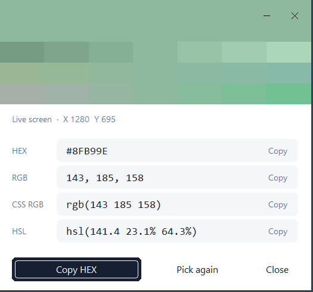

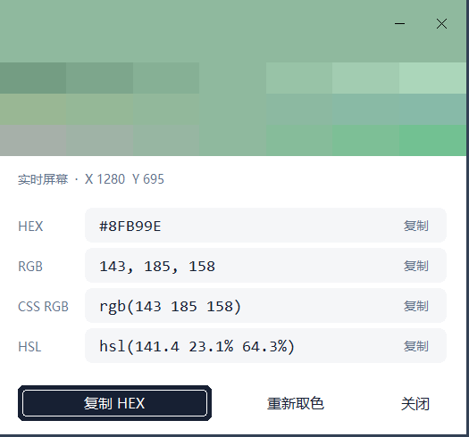

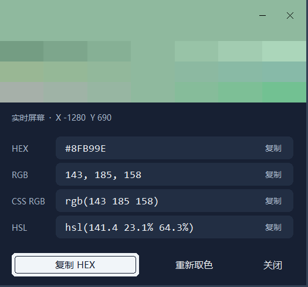

### 设置

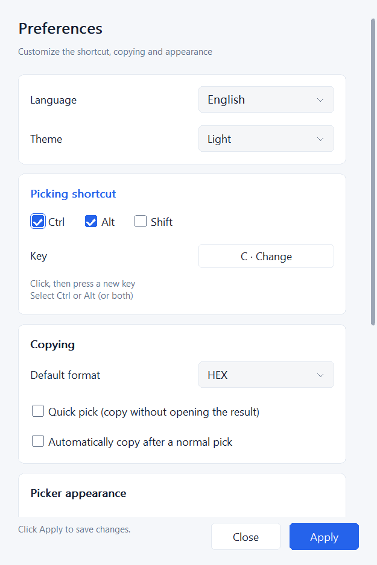

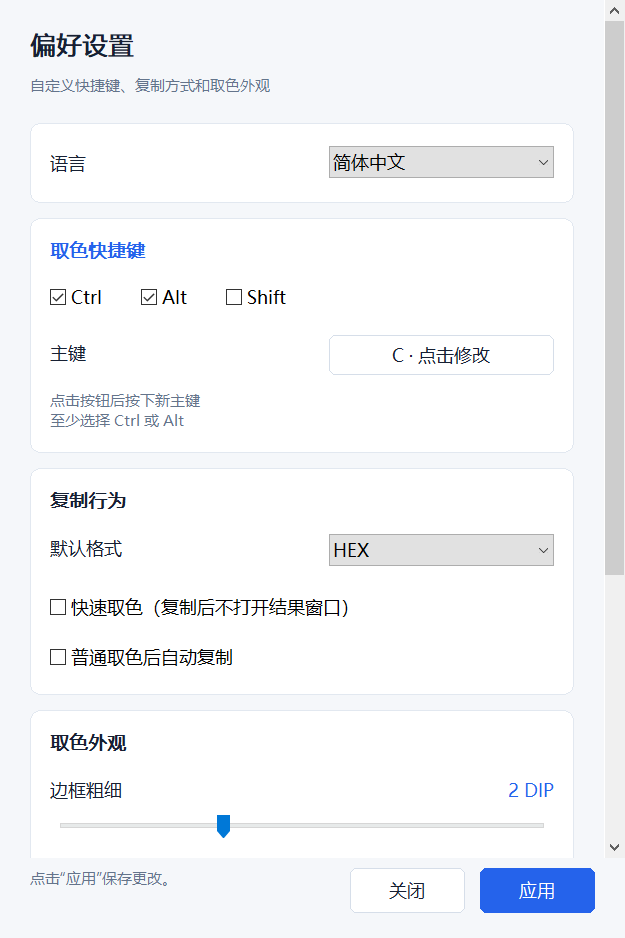

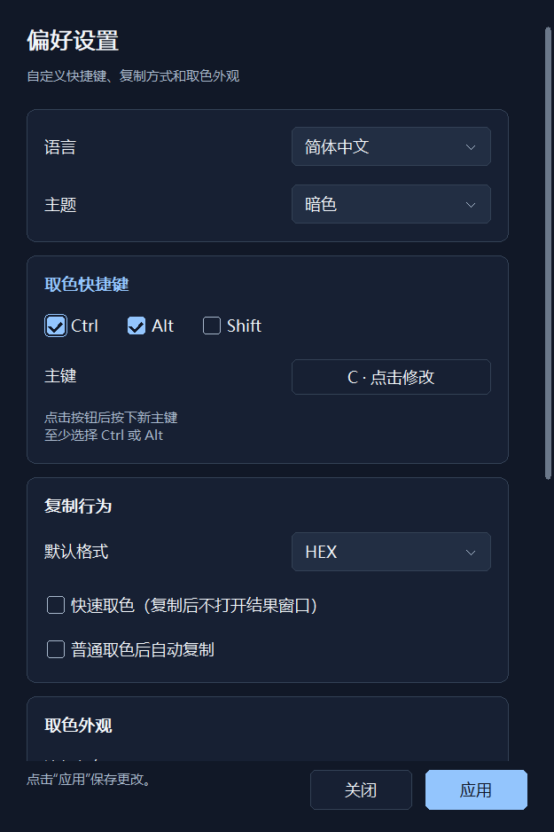

以下为 `--settings-size=500x320` 的紧凑设置预览：内容区出现滚动条，底部状态、关闭与应用按钮保持可见。

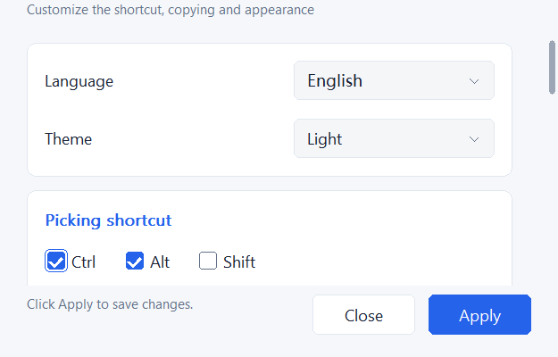

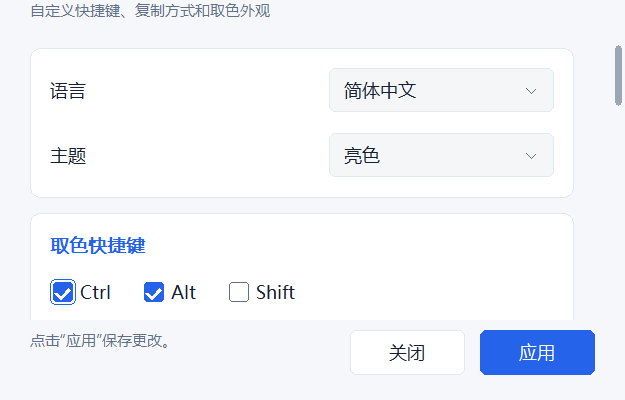

### 实时取色与冻结放大


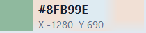


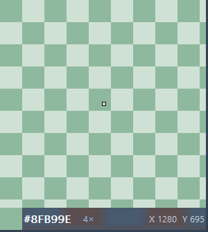

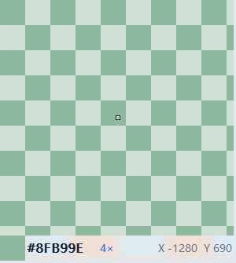


以下是 `frozen-edge` 在工作区左上角导出的当前布局，与中央冻结窗口保持相同尺寸；
工作区不足时才收缩。截图中的色块仍对应初次冻结前的原始焦点：

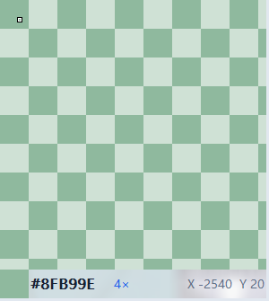
